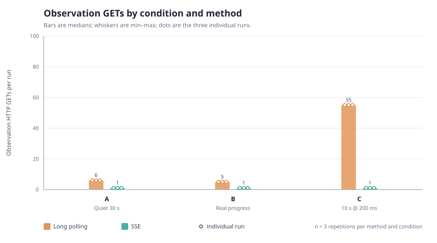
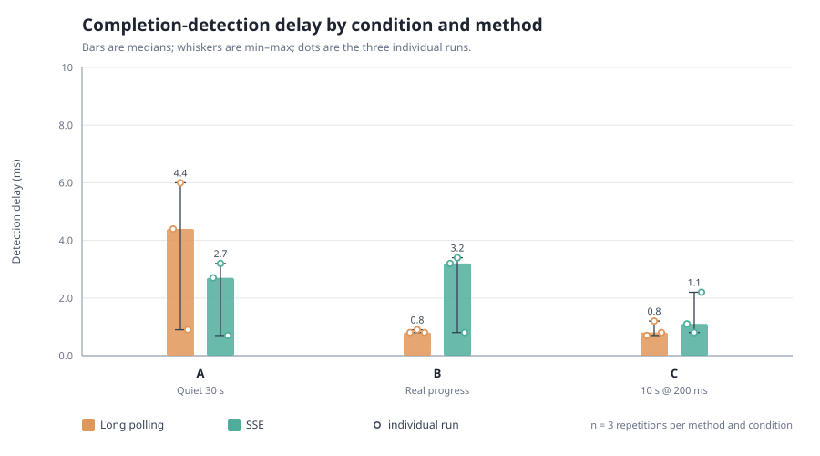
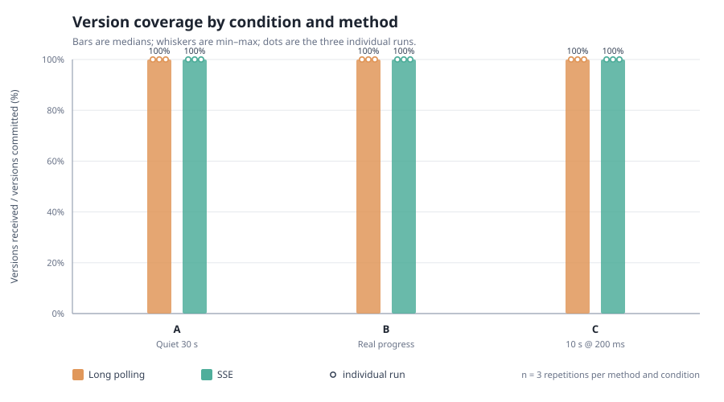

<!-- _class: lead -->

# ImageLab Version 3

## Server-Sent Events vs Long Polling

**Asynchronous image processing — 18-run measured comparison**

Your name · Your student ID · Class date

<!-- 0:00–0:30. Open with the question, not the technology: "Once a job is accepted, how should the browser watch it?" This deck follows the live demo script in experiments/DEMO-V3.md and the analysis in REPORT-V3.md. -->

---

# The question

A job is accepted with **202**, then processed in the background.

The browser must watch authoritative PostgreSQL state until a terminal state.

Three ways to observe it:

| Mode | Mechanism |
| :-- | :-- |
| Short polling | `GET /v1/jobs/{id}` every second |
| Long polling | Hold a `GET` until a newer version commits |
| **SSE (new)** | One `GET /v1/jobs/{id}/events` response, many frames |

**Question:** does a single event stream change request count, detection delay, or version coverage?

<!-- 0:30–1:15. Say which one is new. Short and long polling are the baseline; SSE is Version 3. Keep the framing as a comparison, not a feature announcement. -->

---

# What changed — and what did not

**Unchanged (V1 + V2 contracts):**

- `POST /v1/images` → `202 Accepted` + `Location` / `status_url`
- Durable PostgreSQL jobs, one in-process worker
- Four states, three variants, short and long polling

**New in V3:**

- `GET /v1/jobs/{id}/events` — one long-lived response
- Full job snapshots, one per committed version
- Browser mode, stop/resume, reconnect handling

**Schema unchanged:** migration 5 already has `version`, `stage`,
`variants_completed`, `simulation_step`. There is no migration 6.

<!-- 1:15–2:00. Emphasise that the pipeline was not rewritten. The safest way to add an observation mode is to reuse the same authoritative snapshots and the same commit notification. -->

---

# The endpoint on the wire

```http
GET /v1/jobs/{id}/events HTTP/1.1
```

```http
HTTP/1.1 200 OK
Content-Type: text/event-stream; charset=utf-8
Cache-Control: no-cache

event: job-update
data: {"id":"...","status":"queued","version":1,...}

event: job-update
data: {"id":"...","status":"processing","version":2,...}

```

- Unknown job → **404 before any stream headers**
- `: heartbeat` comment roughly every 10 s; **no `id:` field**
- Terminal snapshot is the last frame, then the server ends the response

<!-- 2:00–3:15. Point at the blank line after each data line: that is the frame delimiter and the flush point. Explain why there is no id/replay contract: frames are complete snapshots, so a reconnect only needs the current state. -->

---

# How a commit reaches every tab

1. Worker commits the new version to PostgreSQL.
2. Broadcaster closes that job's signal channel — **after** commit.
3. Every waiting handler wakes, re-reads PostgreSQL, writes a fresh snapshot.
4. Each observer has its own registration and response; the terminal snapshot ends only that stream.

```
commit → notify → re-read DB → frame → flush → wait
```

**Invariants:** subscribe before read; never send cached state; disconnect releases the registration but never cancels the worker.

Server log: `events_sent`, `heartbeats`, `db_reads`, `duration_ms`, `peak_active_streams`.

<!-- 3:15–4:30. This is the core of the implementation. Stress subscribe-before-read: it closes the race where a commit lands between reading the version and starting to wait. Reusing the V2 broadcaster means no new polling loop and no duplicate worker logic. -->

---

# Browser lifecycle

**One `EventSource` per observed job**

- Initial snapshot and later frames use the same validator and job card as polling.
- **Stop observing** → `EventSource.close()`; job keeps running.
- **Resume observation** → one new `EventSource`; immediate current snapshot.
- Temporary errors → *Reconnecting to the job stream*, never *failed*.
- Fatal close (for example a `502` during restart) → one explicit retry, then a fresh snapshot.
- Terminal frame → observation ends; server has already closed the response.

<!-- 4:30–5:30. If showing the browser live, this is the moment: upload, select SSE, watch "Stream GETs = 1", stop, resume. Say explicitly that the reconnect is observation recovery, not job recovery. -->

---

# Experiment design

**3 conditions × 2 methods × 3 repetitions = 18 runs**

Controls: same generated PNG and settings · one observer · empty queue at each start · method order alternated between conditions · fresh server per condition.

| Condition | Workload | Server flags |
| :-- | :-- | :-- |
| A — quiet | 30 s active, no visible progress | `-quiet-delay 30s` |
| B — real | thumbnail → preview → display | none |
| C — frequent | 10 s labelled phase @ 200 ms, then real work | `-simulate-duration 10s -simulate-interval 200ms` |

Simulated progress never completes a job; only real processing does.

<!-- 5:30–6:30. Walk the controls one by one so the comparison is credible. "One observer" matters: peak_active_streams is 1 in every measured run. Multi-observer behaviour is verified separately in the lifecycle checks. -->

---

# What we measured

**Detection delay**

> client receipt of terminal snapshot − server log time immediately after terminal commit

joined by job id; on loopback the floor is sub-millisecond.

**Other columns**

| Metric | Meaning |
| :-- | :-- |
| `observation_gets` | HTTP requests made only to observe the job |
| `job_events` / heartbeats | SSE frames and idle comments |
| `versions` / gaps / coverage | completeness of the snapshot stream |
| `observation_db_reads` | state reads caused by observation |
| `stream_seconds` | held-response duration (SSE) |

Processing duration is reported separately — detection is **not** processing time.

<!-- 6:30–7:15. Define detection carefully: both methods wake from the same post-commit signal, so this isolates the observation mechanism. At these magnitudes, the spread across repetitions matters more than a single median. -->

---

# Predictions (recorded before the runs)

| Condition | Long polling | SSE |
| :-- | :-- | :-- |
| A quiet | ~5–7 GETs, ≈1 ms | 1 GET, no updates during quiet, ~3 heartbeats |
| B real | ~5–6 GETs, ≈1 ms | 1 GET, ~5 frames, ≈1 ms |
| C frequent | ~50–55 GETs | 1 GET, 50+ frames, few heartbeats |

**Hypothesis:** comparable detection and coverage; SSE wins on GET count; fewer GETs does **not** prove lower total cost.

Predictions are stored in `experiments/v3-predictions.md`.

<!-- 7:15–8:00. Make clear these were written before running the script — they are not fitted to the results. The hypothesis deliberately includes the caveat about total cost. -->

---

# Results — summary (median, min–max)

| Cond | Method | GETs | Detection (ms) | Events | Coverage | DB reads | Stream (s) |
| :-- | :-- | --: | :-- | --: | --: | --: | --: |
| A | long | 6 (6–6) | 4.40 (0.90–6.00) | 0 | 1.00 | 6 | — |
| A | sse | **1 (1–1)** | 2.70 (0.70–3.20) | 5 | 1.00 | 5 | 30.32 |
| B | long | 5 (5–5) | 0.80 (0.80–0.90) | 0 | 1.00 | 5 | — |
| B | sse | **1 (1–1)** | 3.20 (0.80–3.40) | 5 | 1.00 | 5 | 0.24 |
| C | long | 55 (55–55) | 0.80 (0.70–1.20) | 0 | 1.00 | 55 | — |
| C | sse | **1 (1–1)** | 1.10 (0.80–2.20) | 55 | 1.00 | 55 | 10.23 |

18 rows in `experiments/v3/runs.csv`; server logs confirm one DB read per committed version.

<!-- 8:00–9:15. Read the table by column, not by row: GETs first, then detection, then events/coverage. Point out that SSE's 5 and 55 events match the terminal version counts exactly, and that every cell has coverage 1.00. -->

---

# Graph 1 — observation GETs



**SSE is flat at 1 GET in every condition.** Long polling scales with the change rate: 6 → 5 → 55.

<!-- 9:15–10:00. The shape is the message. Condition C is the clearest: the same 55 committed versions cost 55 requests under long polling and one stream GET under SSE. -->

---

# Graph 2 — detection delay



Medians 0.8–4.4 ms with overlapping ranges. The method is not the bottleneck.

Honest caveat: first repetitions after a server start show a 3–6 ms cold-start artifact; later runs settle to 0.7–1.1 ms.

<!-- 10:00–10:45. Do not oversell a difference of a few milliseconds. The whiskers and individual dots show that the spread within a condition is as informative as the difference between methods. -->

---

# Version coverage + lifecycle



**100% coverage in all 18 runs; zero version gaps.**

Separate lifecycle evidence (`experiments/v3-lifecycle/`):

- 13/13 smoke checks pass, including 404-before-stream and terminal close
- Two observers on one job: `peak_active_streams=2`
- Disconnecting observation leaves the worker running to completion

<!-- 10:45–11:30. Coverage is a property of the snapshot contract, not the transport: even if a version were coalesced, the latest snapshot is complete. The lifecycle checks cover the semantic requirements that the 18 performance runs deliberately did not. -->

---

# Predictions vs results

| Prediction | Observed | Verdict |
| :-- | :-- | :-- |
| A/B/C long GET counts | 6 / 5 / 55 | confirmed |
| SSE one GET everywhere | 1 / 1 / 1 | confirmed |
| Detection ≈ 1 ms | medians 0.8–4.4 ms | confirmed with cold-start noise |
| Full version coverage | 1.00 in all cells | confirmed |
| SSE trades requests for held resources | 30.2 s in A, 55 events + 55 reads in C | confirmed |

The only deviation was the cold-start latency artifact; no behavioural prediction failed.

<!-- 11:30–12:00. This slide closes the loop with the pre-run predictions. It is acceptable — and more credible — to report the one deviation rather than smooth it over. -->

---

# Interpretation: the real trade-off

**SSE wins on request profile**

- One HTTP request for the whole observation lifetime
- No repeated headers, deadline rechecks, or request setup per change

**SSE pays for it**

- Holds a handler and connection for the entire run (30.2 s in A)
- Sends one event per committed version (55 in C)
- Performs one database read per wake-up (55 in C)
- Keeps subscriber registrations and does broadcast bookkeeping

**Long polling** uses many short requests with no held handler between them.

Lower request count ≠ lower total server cost.

<!-- 12:00–13:00. This is the slide examiners probe. Be ready to name the resource being traded: held handler, open connection, per-update event traffic, subscriber state. The evidence for each is in the CSV columns and server logs. -->

---

# Limitations

- Loopback only — no WAN latency, packet loss, or proxy buffering
- 3 repetitions per cell — ranges, not confidence intervals
- 1 observer in the measured runs; fan-out verified separately
- 1 worker, 1 server process; no concurrency or load testing
- Condition C is a labelled **simulated** cadence, not processing performance
- HTTP request count is not TCP connection count; held-handler memory and event CPU were not measured

<!-- 13:00–13:45. Say these before the recommendation so the recommendation is clearly bounded by the evidence. -->

---

# Recommendation

| Situation | Choose |
| :-- | :-- |
| Browser watches a job to completion, updates may be frequent | **SSE** |
| Sparse updates; holding a response open is undesirable | **Long polling** |
| Stateless immediate read or fallback | **Prompt `GET`** |

**For ImageLab:** default to **SSE** for observation; keep long polling and short polling as documented alternatives.

All three modes render the same authoritative snapshot, so switching is safe.

<!-- 13:45–14:20. End with a decision, not a summary. The key justification is one stream GET with equal detection and coverage under frequent updates, while explicitly refusing to claim a total-cost win. -->

---

# Questions

**Evidence map**

| Item | Location |
| :-- | :-- |
| Endpoint | `cmd/api/events.go` |
| Browser lifecycle | `frontend/app.js`, `frontend/render.js` |
| 18 runs + summary | `experiments/v3/runs.csv`, `summary.csv` |
| Graphs | `experiments/v3/chart-*.svg` |
| Raw + server logs | `experiments/v3/raw/`, `experiments/v3/logs/` |
| Lifecycle checks | `experiments/v3-lifecycle/` |
| Analysis / script | `REPORT-V3.md`, `experiments/DEMO-V3.md` |

Reproduce: `make experiment-v3` · `make sse-smoke`

<!-- 14:20–15:00. Likely questions: what Flush does (writes the frame without ending the response); how every tab gets a commit (broadcast closes the signal, each handler re-reads the DB); what happens on disconnect (only the handler ends); why no replay (snapshots, not deltas). -->

<!--
How to present this deck:
- In VS Code, install the Marp for VS Code extension, open this file, and choose "Marp: Open Preview".
- Or use marp-cli: npx @marp-team/marp-cli PRESENTATION-V3.md --pdf
- Present fullscreen (F11). HTML comments are speaker notes.
-->
